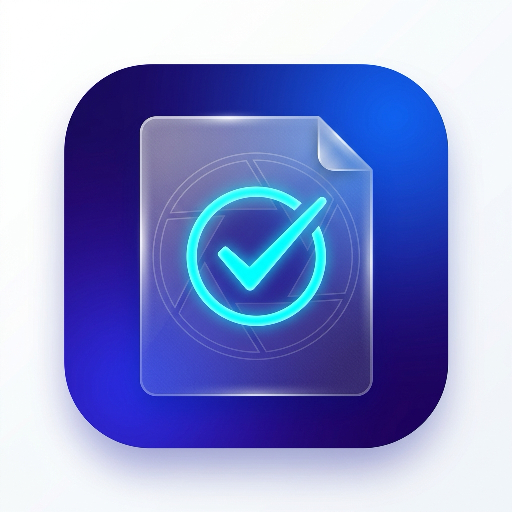

# 📁 SahiFile — All-in-One Photo & PDF Tools

<p align="center">
  
</p>

<p align="center">
  <strong>"Make every file upload-ready — 100% On-Device & Private."</strong>
</p>

<p align="center">
  
  
  
  
  
  
</p>

---

## 📖 Overview

**SahiFile** is a premium, high-performance Flutter Android application crafted specifically for government job applicants, students, exam candidates, and professionals who need their files to meet strict portal specifications (SSC, UPSC, State PCS, Banking, NTA NEET/JEE, Police recruitment, Passport Seva, and visa applications).

Unlike web tools that upload sensitive documents to remote servers, **SahiFile runs 100% on-device**, ensuring complete confidentiality, zero latency, and zero internet dependency.

---

## 🌟 Core Feature Suite

### 1. 🔄 PDF Page Sequence Reorganizer (iLovePDF Style)
- **Multi-Page Handling (100+ Pages)**: Seamlessly loads documents with dozens or hundreds of pages without running out of memory.
- **Visual Thumbnail Streaming**: Progressively streams page thumbnails in the background via native rasterization (`Printing.raster`).
- **Drag-and-Drop Reordering**: Rearrange the page sequence intuitively in a responsive grid.
- **Per-Page Controls**:
  - 🔄 **Rotate 90° Clockwise**: Fix individual scanned pages that are upside-down or sideways.
  - 📑 **Duplicate**: Duplicate any page into the sequence.
  - 🗑️ **Delete with Undo**: Instantly remove unwanted pages with a safety snackbar undo action.
  - 🔍 **Tap to Zoom**: Pinch-to-zoom interactive viewer to inspect small text or stamps.
- **Batch Sequence Tools**:
  - 🔄 **Rotate All 90°**: Rotate all pages simultaneously.
  - ↕️ **Reverse Sequence**: Invert the entire sequence (e.g., 100 → 1).
  - ↩️ **Reset**: Restore the initial page sequence and orientation.
  - ➕ **Insert Another PDF**: Append pages from another document into the workflow.

---

### 2. 🎯 Exact KB Target Image Compression
- **Smart Binary Search Quality Search**: Iteratively targets strict upload caps (e.g., `< 50 KB`, `< 20 KB`, `< 100 KB`).
- **Maximum Clarity Preservation**: Finds the optimal JPEG compression matrix without unnecessary blur or artifacts.
- **Background Isolate Processing**: Heavy image encoding runs on background isolates to keep the UI smooth at 60/120 fps.

---

### 3. 🖼️ Smart Photo & Signature Resizer
- **Aspect Ratio Locking & Freeform Crop**: Built-in presets for passports (35×45mm), exam portals (SSC/UPSC/IBPS 3.5×4.5cm), signatures (2:1 ratio, under 20 KB), and custom pixel dimensions.
- **Live Parallel Crop Preview (PiP)**: Real-time hardware-accelerated Picture-in-Picture window showing the cropped result dynamically as you drag or resize handles.
- **Alpha Channel / Transparency Protection**: Automatically renders PNG signatures onto clean white backgrounds or preserves transparency, preventing black background glitches on government portals.

---

### 4. 📄 Images to PDF Document Creator
- Convert multiple camera photos or gallery images into standardized **A4** or **US Letter** PDFs.
- Reorder pages before generation.
- Choose page orientation (Portrait, Landscape, or Auto-fit).
- Configure edge margins and fit modes (Fit to page vs Fill page).

---

### 5. 🔀 Offline PDF Merge & Optimizer
- **Merge 2+ Documents**: Combine certificates, marksheets, and IDs into one unified PDF locally.
- **PDF Compression**: Optimizes existing PDF structures without sending files to third-party cloud converters.

---

### 6. 📱 Interactive Previews & Direct Root Storage Saving
- **End-of-Editing Interactive Previews**:
  - **Photos**: High-resolution image preview with full-screen pinch-to-zoom modal.
  - **PDFs**: Real-time rasterized document preview of Page 1 with full-screen pinch-to-zoom modal.
- **Direct Root Storage Saving (No Hidden Subfolders)**:
  - **Photos**: Saved directly to the root **Gallery / Camera Roll / Pictures**, showing up immediately at the top of your phone's main Photos and Gallery tabs.
  - **PDFs**: Saved directly to the root **Downloads & Documents** directory (`/storage/emulated/0/Download/`), immediately visible in the phone's Downloads and Files apps.
- **Zero Permission Crashes**: Uses Android MediaStore ContentResolver via `file_saver` to save files without requiring risky permissions or causing `Permission denied (errno = 13)` errors on Android 10, 11, 12, 13, and 14+.

---

## 🎨 Design System & Aesthetics

- **Glassmorphism**: Translucent surfaces, subtle borders, and blur filters.
- **Adaptive Theming**: Seamless switching between Dark Mode and Light Mode.
- **Bilingual Interface**: Full localization support for both **English** and **Hindi (हिन्दी)**.
- **Zero Layout Overflows**: Hardened with responsive `Flexible`, `Expanded`, `Wrap`, and bounded layout builders to guarantee zero RenderFlex overflow across narrow devices and large font scales.
- **Clear Feedback**: Actionable error dialogs with guidance on how to fix issues.

---

## 🏗️ Architecture & Project Structure

The codebase is organized following **Clean Architecture** and **Feature-First** principles:

```
lib/
├── app/
│   ├── app.dart                  # MaterialApp root, themes, and shell routing
│   ├── providers.dart            # Global Riverpod providers & dependency injection
│   └── theme/                    # AppColors, AppSpacing, GlassSurface, AppTheme
├── core/
│   ├── constants/                # App constants, preset dimensions, route names
│   ├── errors/                   # AppError and AppErrorCode definitions
│   ├── localization/             # AppStrings (English & Hindi translations)
│   ├── models/                   # Result<T> monad (Success/Failure)
│   ├── utils/                    # FileUtils (MediaStore, Gal, FileSaver), Formatters
│   └── widgets/                  # AppButton, AppDialog, GlassAppBar, StatusBadge
└── features/
    ├── history/                  # Local export history with search and cleanup
    ├── home/                     # Hero banner, quick tool cards, recent files list
    ├── onboarding/               # First-time feature walkthrough carousel
    ├── pdf_tools/
    │   ├── data/services/        # PdfService (Syncfusion + Printing + Pdf package)
    │   ├── domain/models/        # PdfPageReorganizeItem, PdfToolResult, ImagesToPdfParams
    │   └── presentation/screens/ # PdfOrganizeScreen, ImagesToPdfScreen, PdfMergeScreen, PdfCompressScreen, PdfResultScreen
    ├── photo_editor/
    │   ├── data/services/        # ImageProcessingService (isolate-based binary search)
    │   ├── domain/models/        # PhotoEditParams, PhotoEditResult, OutputFormat
    │   └── presentation/screens/ # PhotoSetupScreen, CropEditorScreen, PhotoResultScreen
    ├── presets/                  # Preloaded exam/portal presets with custom CRUD
    ├── settings/                 # Theme toggle, language switcher, cache cleaner, about
    └── tools/                    # Categorized tools hub
```

---

## 🛠️ Tech Stack & Dependencies

| Category | Package | Purpose |
| :--- | :--- | :--- |
| **Framework** | Flutter `3.29+` / Dart `3.7+` | Cross-platform core |
| **State Management** | `flutter_riverpod: ^3.3.2` | Reactive state & dependency injection |
| **Image Processing** | `image: ^4.5.4` | Isolate-based image decoding, rotation & encoding |
| **PDF Engine** | `syncfusion_flutter_pdf: ^31.1.19` | Low-level PDF template extraction & merging |
| **PDF Generation** | `pdf: ^3.11.3` | High-level PDF document creation & pagination |
| **PDF Rasterization** | `printing: ^5.14.3` | Native high-speed PDF page rasterization & preview |
| **Reorderable Grid** | `reorderable_grid: ^1.0.13` | Drag-and-drop page sequence grid |
| **Media & Storage** | `file_saver: ^0.3.1` | Permission-free MediaStore storage saving |
| **Gallery Integration** | `gal: ^2.3.3` | Camera roll / Photo library indexing |
| **File Picker** | `file_picker: ^11.0.3` | System file picker for PDF selection |
| **Photo Picker** | `image_picker: ^1.2.1` | Native gallery and camera picker |
| **Persistence** | `shared_preferences: ^2.5.3` | Settings & preset caching |
| **Sharing** | `share_plus: ^10.1.4` | System sharing sheet |

---

## 🚀 Getting Started

### Prerequisites
- [Flutter SDK](https://flutter.dev/docs/get-started/install) (`^3.29.0`)
- [Dart SDK](https://dart.dev/get-dart) (`^3.7.0`)
- Android Studio / Android SDK (Min API 21, Target API 35)

### Installation

1. **Clone the repository**:
   ```bash
   git clone https://github.com/your-username/sahifile.git
   cd sahifile
   ```

2. **Install dependencies**:
   ```bash
   flutter pub get
   ```

3. **Verify static analysis**:
   ```bash
   flutter analyze
   ```

4. **Run automated tests**:
   ```bash
   flutter test
   ```

5. **Run the application**:
   ```bash
   flutter run
   ```

6. **Build an Android Debug / Release APK**:
   ```bash
   # Debug APK
   flutter build apk --debug

   # Release APK
   flutter build apk --release

   # Production App Bundle for Google Play
   flutter build appbundle --release
   ```

---

## 🧪 Automated Test Suite

SahiFile includes a comprehensive suite of unit and widget tests:

```bash
flutter test
```

### Coverage Overview:
- `test/core_unit_test.dart`: Validates file size formatters, dimensions formatting, safe file naming, and `Result<T>` error branching.
- `test/presets_and_history_unit_test.dart`: Validates preset repository defaults, custom preset CRUD, and history persistence.
- `test/pdf_organize_unit_test.dart`: Validates multi-page PDF reorganization, page rotation angles, page sequence inversion, and page duplication.
- `test/custom_dialog_test.dart`: Validates error dialog rendering and action triggers.
- `test/widget_test.dart`: Validates `SahiFileApp` bootstrap, theme injection, and navigation.

---

## 🔒 Privacy & Security

- **Zero Cloud Storage**: All operations occur entirely inside the device's sandboxed memory and temporary cache.
- **Zero Analytics / Tracking**: No third-party analytics SDKs, trackers, or telemetry.
- **Non-Destructive Processing**: Input files are never overwritten. A temporary working copy is processed, and outputs are saved as new files.
- **One-Tap Cache Cleaner**: Easily wipe temporary working files at any time via **Settings → Storage & Cache → Clear Cache**.

---

## 📄 License

Copyright © 2026 SahiFile. All rights reserved.
Licensed for personal and commercial use under project licensing terms.
